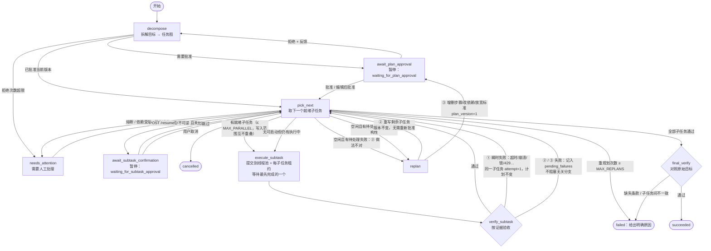
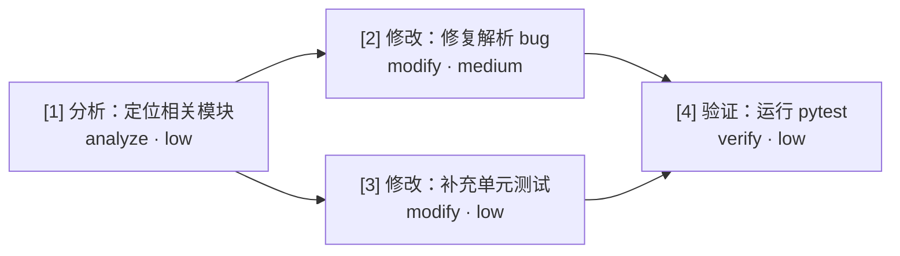

# local-agent-workflow

本地优先的 AI 编程 Agent 工作流（v0.3.6）。给定一个目标（如“修复某个 bug”），后端调用
DeepSeek（OpenAI 兼容接口）以 ReAct 方式在**指定工作区**内真实地读代码、改代码、
运行测试验证，高风险操作需要用户批准，全过程记录在 SQLite 中，写入前自动快照可回滚。

> ⚠️ 这是一个会**真实修改文件、执行命令**的 Agent。请只把它指向你愿意让它修改的项目目录。

## 功能

- **FastAPI 本地 API**：创建/查询任务、查看执行步骤、审批、补充信息。
- **任务拆解工作流（v0.3.0）**：目标先拆成子任务 DAG（任务图），经用户批准后按依赖顺序
  逐个执行，每个子任务按**证据**验收，失败按三类分支处理，最后对照原始目标做最终验收。
  详见下文“架构：控制循环 + 任务图”。
- **v0.3.1 补齐**：子任务**写入范围契约**（`write_scope`，工具层强制）、批准前静态检查
  （写入范围重叠必须有依赖路径、modify 必须声明范围）、**目标条款追踪**（原始目标冻结并编号
  C1..Cn，最终验收逐条报告）、**只追加的计划版本历史**（API + 前端版本选择器与 diff 高亮）、
  **并行执行**（`MAX_PARALLEL`，按写入范围互斥调度，每个子任务独立租约与心跳）。
- **v0.3.2 限制优化**：缓存/产物类命令（pytest、npm test|build、npx tsc、mypy 等）重定向到
  `.agent_scratch/<run>/<subtask>/` 并在结束后做范围外写入检测与恢复；目标条款混合拆分
  （标点/列表 + 中英文连词启发式，可选 `GOAL_CLAUSE_LLM_SPLIT`）；协作式取消（进程树杀掉、
  审批/提问等待立刻中止、中断子任务标为 cancelled）。
- **v0.3.3 残留限制修复**：常见产物/缓存目录（`dist/`、`build/`、`.next/`、`__pycache__` 等）
  按 `ARTIFACT_PATH_GLOBS` + `ARTIFACT_POLICY=allow|restore|fail`（默认 allow）处理，不再误报
  `scope_violation`；最终验收失败可在 `FINAL_VERIFY_REPLAN` 下触发受预算约束的重规划
  （`FINAL_VERIFY_MAX_REPLANS`，默认 1），计划版本原因与前端可展示。
- **v0.3.4 边角收口**：取消可中止进行中的模型 HTTP（`CancelToken` 关闭 httpx Client）；
  有 `write_scope` 时命令一律走 scratch 快照 + `TMP`/`PYTHONPYCACHEPREFIX` 重定向与软路径检查
  （`COMMAND_SOFT_SANDBOX`，仍非内核沙箱）；旧计划缺 `write_scope` 时 analyze→只读、modify 在
  `LEGACY_WRITE_SCOPE_STRICT=true`（默认）下阻塞直至 PATCH 补齐。
- **v0.3.5 边角加固**：审批/提问等待状态持久化在 SQLite，进程重启后由 approve/input 走 resume；
  新增 `GET /runs/{id}/events`（SSE）推送 status/step/approval/input，前端优先 EventSource、
  断开时仍轮询；Windows 上命令尽量挂到 Job Object（kill-on-close）；`COMMAND_READONLY_FS_HINT`
  在只读子任务拒绝声明写入；`COMMAND_DENY_NETWORK`（默认 false）仅剥离代理环境变量（非防火墙）；
  模型取消增加短连接超时 + `CANCEL_FORCE_MS` 看门狗，可放弃卡住的 httpx 线程。
- **v0.3.6 残留缓解**：`run_events` 表持久化 SSE 事件，`?after_seq=` 重连可回放；默认
  `EVENTS_DB_TAIL` 从 SQLite 追尾（WAL），多 worker 时仍建议 `workers=1`；
  `COMMAND_BLOCK_NETWORK_TOOLS` + 只读子任务拒联网启发式；`COMMAND_DENY_NETWORK` 对 Python
  子进程注入 `sitecustomize` 拦截 `socket.connect`（原生二进制仍可联网）；LLM 取消带
  `CANCEL_JOIN_MS` 与 abandoned 丢弃迟到响应，专用 Client 避免连接池卡死。
- **ReAct 执行器**（`app/agents/agent_executor.py`）：模型 → 工具 → 结果循环，带总轮次、
  分阶段（分析/修改/验证）预算、模型调用次数、总时长、无进展检测等硬性限制。
  “成功”只依据真实证据判定：有工具调用、修改后有通过的验证命令、最后一步未失败。
- **工具**（`app/tools/registry.py`）：`list_files`、`read_file`、`search_code`、`write_file`、
  `edit_file`、`rollback_file`、`run_project_command`、`check_port`、`check_http`、
  `get_task_logs`、`ask_user`。
- **安全策略**：路径限制在工作区内；命令白名单 + 参数级分析（pytest / ruff / mypy /
  `python -m` / `uv run` / `npm test|run` / `npx tsc`），每次调用判定为放行 / 需审批 / 拒绝；
  格式化/安装类命令声明 `writes` 受 `write_scope` 约束，缓存/产物类命令重定向到
  `.agent_scratch/` 并拒绝范围外逃逸；工具输出与日志脱敏；`.env` 等受保护文件读写受限。
- **审批**：需审批的操作暂停为 `waiting_for_approval`，在 UI 或 `POST /runs/{id}/approve`
  批准/拒绝；批准是一次性的，并绑定具体工具与参数。`REQUIRE_APPROVAL=false` 时自动放行
  （仍记录日志），但“拒绝”类规则永远不放开。
- **补充信息**：Agent 可调用 `ask_user` 提问，任务进入 `waiting_for_input`，在 UI 或
  `POST /runs/{id}/input` 回复后继续；超时（`INPUT_WAIT_SECONDS`）则不带回复继续。
- **超时**：每个工具都有硬超时；`run_project_command` 的 `timeout_seconds` 上限为
  `MAX_COMMAND_TIMEOUT_SECONDS`，超时会结束整个进程树。
- **写保护与回滚**（`app/write_guard.py`）：写前快照、原子写入、版本校验、防整体截断；
  人工回滚 CLI 见下文。
- **断点恢复**：检查点 + 持久化对话 + 执行租约；服务重启时，租约心跳仍新鲜（另一进程在跑）
  的任务保持 `running`，心跳过期的判定为崩溃并标记 `interrupted`（不自动重放），
  `POST /runs/{id}/resume` 按检查点幂等恢复。
- **上下文与记忆**：按项目缓存文件与符号索引（`data/context_cache.sqlite3`），压缩旧工具输出。
- **Web 控制台**（`frontend/`，React + Vite + React Flow）：提交任务、查看任务图（按状态着色）与子任务详情、批准/拒绝计划、确认高风险子任务、人工接管、查看步骤、审批、回复提问。

## 架构：控制循环 + 任务图

系统分两层，**互不混用**：

1. **控制循环（固定，所有目标都一样）**——`app/engine/workflow.py`，LangGraph 条件边实现。
2. **任务图（每个目标不同）**——`app/engine/planning.py`，规划器为当前目标生成的子任务 DAG；
   前端画的就是这张图，按子任务状态着色。

### 控制循环



要点：

- **三类失败分支**（`planning.classify_failure`）：
  1. **瞬时**（`task_timeout`、模型/网络错误、进程崩溃、`database is locked`、HTTP 429/5xx）：
     重试**同一个**子任务，`attempt_number+1`，任务图不变；重试带上一尝试的检查点，已落盘的写入经
     哈希核对后跳过，不重复执行。达到 `MAX_SUBTASK_ATTEMPTS` 后升级为结构性。
  2. **做法不对（范围内）**：只重写剩余（未完成）子任务，id / 依赖 / 验收标准不变，`plan_version`
     不变，**不需要**重新批准。重规划结果会与旧图做 diff：只要改了步骤、依赖、验收标准等结构字段，
     就自动升级为第 3 类。
  3. **结构性**（增删步骤、改依赖、放宽标准，或执行器被阻断/尝试次数耗尽）：`plan_version+1`，
     回到计划审批；**只执行已批准的版本**（`approved_version == version`）。
- 拒绝计划必须带反馈，回到 decompose 按反馈重新拆解，次数受 `MAX_PLAN_REJECTIONS` 限制，
  超过后进入 `needs_attention`，不会直接结束。
- **高风险/不可逆子任务**（`risk=high` 或 `reversible=false`）即使计划已批准，**开始前**也会暂停
  确认。规划器为每个子任务标注 `risk`；静态检查拒绝“不可逆却未标 high”或“描述含删除/迁移/
  发布等危险字样却标 low”的计划。
- **熔断**：`MAX_RUN_STEPS` / `MAX_RUN_SECONDS` / `MAX_RUN_TOKENS` 任一触发 → `needs_attention`
  并写明原因（不是静默失败）；调大配置后可 `POST /runs/{id}/resume` 继续。
- **取消**：`POST /runs/{id}/cancel`。暂停中的任务立即变为 `cancelled`；执行中的任务在当前
  子任务结束时停止（正在等待的工具审批/提问按“拒绝”处理）。
- **最终验收是独立出口，不是子任务**，重规划无法删掉它；子任务全部通过 ≠ 目标达成。它只检查
  **合并结果 vs 原始目标**，不重复逐个子任务的验收：
  - 规则检查：是否有未完成子任务；目标要求改代码却没有任何文件变更证据；各文件当前磁盘哈希是否
    与最后一次证据一致（后续子任务是否悄悄改回/改坏）；最后一次修改之后是否有通过的验证命令。
  - 可选模型复核（`FINAL_VERIFY_LLM=true` 且启用规划器）：只输出原始目标中**遗漏的条款**和
    **子任务之间的矛盾**。
- **目标条款追踪**：原始目标在第一次拆解时**冻结**（存于 `run_plans.goal_json`，之后任何写入若改动
  目标或条款会被拒绝），并确定性地按句末标点/换行/列表编号拆成 `C1..Cn`（最多 12 条）。每个子任务
  必须有 `serves_clauses`；静态检查拒绝“子任务不引用条款 / 引用不存在的条款 / 有条款没被覆盖”。
  重写、结构性重规划、拒绝后重新拆解都沿用同一组条款。最终验收在 `final_verify.clauses` 中逐条
  给出：覆盖它的**已验收**子任务及其证据摘要，或 `missing`（任何条款缺失 → 最终验收不通过）。
- **从不信任执行器的自述**：验收只看 `acceptance_evidence`——命令证据（程序/参数/是否通过/
  输出摘要，含退出码）、文件证据（路径 + sha256）；执行器状态仅作参考记录。

### 任务图（每个目标一张 DAG）



- 子任务字段：`id`、`title`、`description`、`depends_on`、`kind`（analyze / modify / verify）、
  `acceptance_criteria`、`risk`（low / medium / high）、`reversible`、`write_scope`、
  `serves_clauses`、`derived_from`（上一版本中的来源子任务）；运行时字段：`status`
  （pending / running / done / failed / skipped / cancelled）、`attempt_number`、`attempts_log`、
  `acceptance_evidence`、`manual`、`interventions`、`duration_seconds`、`tokens`、`result_summary`。
- **就绪** = 所有依赖都是 `done`（`skipped` 不算满足依赖）。
- **写入范围（`write_scope`）**：相对工作区的路径/glob 列表（`app/parser.py`、`app/**`、
  `tests/test_*.py`）。不含通配符的路径表示该文件**及其下所有内容**；`**` 跨多级目录；拒绝绝对路径、
  盘符和 `..`；Windows 下不区分大小写。**空范围 = 只读**；analyze / verify 默认只读，modify 必须声明
  非空范围。执行时在工具层强制：`write_file` / `edit_file` / `rollback_file`（按事务的目标文件），以及
  **声明了写入的命令**（`ruff format`、`ruff check --fix` 的目标；`npm install/ci/add…`、`pip`、
  `uv add/sync/lock/pip`、`python -m pip`、`uv run pip` 的依赖文件与 `node_modules/`、`.venv/`）。越界写入
  在请求审批**之前**就被拒绝，返回明确错误，并作为 `scope_violation` 证据记录到该子任务。
- **批准前的静态检查**（与已有检查一样：无效 → 把错误反馈给规划器重试一次 → 仍无效则回退为单子任务）：
  两个子任务写入范围重叠但彼此之间（任一方向）没有依赖路径 → 拒绝；modify 子任务写入范围为空 → 拒绝；
  目标条款覆盖规则见上。
- **并行执行（`MAX_PARALLEL`，默认 2；1 = 严格串行）**：LangGraph 图本身保持单线程作为控制循环，
  只有执行器调用（`run_agent`）提交到每次运行自己的线程池（`RunContext`）。`pick_next` 一次最多启动
  `MAX_PARALLEL` 个就绪子任务，前提是它们的写入范围彼此不重叠、也不与正在执行的子任务重叠（重叠的排队，
  升级前的旧计划节点没有 `write_scope` 时视为可写任意位置、与所有节点冲突）；`execute_subtask` 等待最先
  完成的一个交给验收，其余继续运行。每个子任务持有**独立的执行租约**（表 `subtask_leases`）并由后台线程
  心跳；某一分支失败只记入 `pending_failures`，等没有执行中、也没有无关的就绪子任务时才重规划/失败，
  不会阻塞无关分支；暂停（计划审批、高风险确认、熔断、取消）也会先等执行中的子任务结束。熔断按
  “已结算 + 执行中实时”的步数/token 计算，步数预算在并行启动时预留；所有 SQLite 写入经进程级锁串行化，
  计划修改在控制线程上进行。工具审批/提问同一时刻只弹出一个（其余子任务排队等待）。
- 验收规则按类型：analyze 需要执行成功 + 至少一次工具调用；modify 需要文件变更证据，且验证命令
  不能只有失败；verify 需要通过的命令/检查证据。
- 持久化（SQLite）：`run_plans`（`plan_version`、整张任务图 JSON、冻结的 `goal_json`）、
  `subtask_leases`（每个子任务一行：租约 + 执行器对话状态，并行安全的断点恢复用它）、
  `plan_versions`（只追加的版本历史）；`run_steps` 带 `subtask_id`、`attempt_number`。旧库启动时自动迁移
  （v0.3.0 的单个 `execution_lease_json` 会迁入 `subtask_leases`）。
- **计划版本历史（只追加，从不覆盖）**：主键 `(run_id, version, revision)`。结构性变化（结构性重规划、
  拒绝后重新拆解、结构性人工修改/编辑后批准）→ `version+1, revision=1`；非结构性变化（重写剩余子任务、
  只改标题）→ 同一 `version` 下 `revision+1`。每条记录保存 `parent_version` / `parent_revision`、
  `reason`、失败分类（`rejected` / `rewrite_remaining` / `structural` / `manual_edit` …）、`created_at`、
  完整任务图快照（含每个子任务的 `derived_from` 血缘）以及相对父版本的 diff。
- **执行租约**（每个子任务一份）：开始一次尝试前以 CAS（`BEGIN IMMEDIATE`）获取该子任务的租约并周期性心跳
  （`LEASE_HEARTBEAT_SECONDS`）。恢复时：同一尝试处于等待审批/提问 → 继续该尝试；
  心跳未过期且持有者是别的进程 → 不抢占（`needs_attention`）；心跳过期 → 判定崩溃，
  `attempt+1` 并用检查点幂等恢复（记录 `crash_recovery` 干预）。
- **人工接管**（任务暂停时）：可修改未成功子任务的契约（改标题等是非结构性的；改依赖/描述/
  验收标准/类型/风险是结构性的 → 新版本 + diff 写入 history + 回到计划审批），或人工标记结果
  （说明 + 证据文本），在证据与图中都标为 `manual`。
- 每个子任务记录尝试次数/重试、干预、耗时、token 及估算费用（`TOKEN_PRICE_*`），并汇总到整次运行。
- `PLANNER_ENABLED=false` 时退化为“单子任务”模式，与 v0.2.0 的执行行为一致。

### 新增 API

| 方法 | 路径 | 说明 |
| --- | --- | --- |
| GET | `/runs/{id}/events` | SSE：status/step/approval/input/state（进程内推送；轮询仍为兜底） |
| GET | `/runs/{id}/plan` | 任务图 + 租约（`leases` 为每子任务租约，`lease` 为最近心跳的一份，兼容旧前端）+ `plan_revision`、`max_parallel`、`clause_report` + token/费用 |
| GET | `/runs/{id}/plan/versions` | 只追加的版本历史摘要（版本、修订、父版本、原因、失败分类、时间、子任务数）+ 冻结的目标条款 |
| GET | `/runs/{id}/plan/versions/{v}?revision=r` | 某个历史版本的完整任务图 + 相对父版本的 diff（不传 `revision` 取该版本最新修订） |
| POST | `/runs/{id}/plan/approve` | `{"decision":"approve","subtasks":[...可选，编辑后的剩余子任务]}` 或 `{"decision":"reject","feedback":"..."}`（兼容 `{"approved":true}`） |
| POST | `/runs/{id}/subtasks/{sid}/confirm` | 高风险子任务执行前确认：`{"approved":true|false,"note":"..."}`，拒绝即跳过 |
| PATCH | `/runs/{id}/subtasks/{sid}` | 暂停时修改子任务契约（可改 `write_scope`、`serves_clauses`；结构性修改会升版本并回到计划审批，非结构性记一个新修订；同样经过静态检查） |
| POST | `/runs/{id}/subtasks/{sid}/manual-result` | 人工标记结果：`{"status":"done|failed|skipped","note":"...","evidence_text":"..."}` |
| POST | `/runs/{id}/resume` | 从 `needs_attention` / `interrupted` / `failed` 继续 |
| POST | `/runs/{id}/cancel` | 取消任务 |

`GET /runs/{id}/steps` 的每一步带 `subtask_id`、`attempt_number`。新增运行状态：
`waiting_for_plan_approval`、`waiting_for_subtask_approval`、`needs_attention`、`cancelled`。

### 新增配置（均已写入 `.env.example`）

| 键 | 默认 | 说明 |
| --- | --- | --- |
| `PLANNER_ENABLED` | `true` | 是否调用模型拆解；`false` = 单子任务模式 |
| `PLAN_REQUIRES_APPROVAL` | `true` | 计划（及结构性重规划）是否需要用户批准 |
| `MAX_SUBTASKS` | `8` | 每张任务图最多子任务数 |
| `MAX_REPLANS` | `2` | 重规划（重写 + 结构性）总次数上限，超过则失败并说明原因 |
| `MAX_SUBTASK_ATTEMPTS` | `3` | 单个子任务瞬时重试的尝试上限 |
| `MAX_PLAN_REJECTIONS` | `3` | 计划被拒绝的次数上限，超过进入 needs_attention |
| `PLANNER_OVERVIEW_MAX_CHARS` | `4000` | 提供给规划器的项目概览长度 |
| `FINAL_VERIFY_LLM` | `true` | 最终验收是否追加模型复核（规则检查始终执行） |
| `SUBTASK_MAX_ITERATIONS` | `20` | 每个子任务的 ReAct 轮次预算 |
| `SUBTASK_TIMEOUT_SECONDS` | `600` | 每个子任务的时长预算 |
| `MAX_RUN_STEPS` / `MAX_RUN_SECONDS` / `MAX_RUN_TOKENS` | `200` / `3600` / `2000000` | 整次运行熔断阈值 |
| `LEASE_TTL_SECONDS` / `LEASE_HEARTBEAT_SECONDS` | `120` / `10` | 执行租约过期时间 / 心跳间隔 |
| `MAX_PARALLEL` | `2` | 同时执行的子任务上限（写入范围互不重叠才会并行）；`1` = 严格串行 |
| `TOKEN_PRICE_INPUT_PER_1K` / `TOKEN_PRICE_OUTPUT_PER_1K` / `COST_CURRENCY` | `0.002` / `0.008` / `CNY` | 费用估算单价（仅估算，请按实际价格调整） |

## 环境要求

Python 3.12+，推荐 `uv`；前端需要 Node.js。

## 安装

```bash
uv sync --extra dev
```

不用 uv：
```bash
python -m venv .venv
# macOS/Linux: source .venv/bin/activate
# Windows PowerShell: .venv\Scripts\Activate.ps1
pip install -e ".[dev]"
```

复制 `.env.example` 为 `.env`，至少填写 `DEEPSEEK_API_KEY`。**不要提交 `.env`。**

主要配置（完整列表见 `.env.example` 与 `app/config.py`）：

| 变量 | 说明 | 默认 |
| --- | --- | --- |
| `DEEPSEEK_API_KEY` / `DEEPSEEK_BASE_URL` / `DEEPSEEK_MODEL` | 模型接口 | – / `https://api.deepseek.com` / `deepseek-chat` |
| `WORKSPACE_PATH` | 未指定工作区时的默认工作区 | 本项目根目录 |
| `REQUIRE_APPROVAL` | 高风险操作是否需要批准 | `true` |
| `APPROVAL_WAIT_SECONDS` / `INPUT_WAIT_SECONDS` | 等待批准 / 回复的时长 | `300` / `600` |
| `TOOL_TIMEOUT_SECONDS` / `MAX_COMMAND_TIMEOUT_SECONDS` | 工具默认超时 / 命令超时上限 | `60` / `600` |
| `TASK_TIMEOUT_SECONDS` | 单个任务总时长 | `900` |
| `LOCAL_AGENT_TOKEN` | API 共享令牌（空 = 不鉴权） | 空 |
| `CORS_ORIGINS` | 允许的前端来源（逗号分隔） | 本地 5173–5175 端口 |

## 运行

后端：
```bash
uv run uvicorn app.main:app --reload
# 或：.venv\Scripts\python -m app.main
```
打开 http://127.0.0.1:8000/docs 和 http://127.0.0.1:8000/health 。

前端：
```bash
cd frontend
npm install
npm run dev   # http://127.0.0.1:5173
```
如需修改后端地址或启用令牌，复制 `frontend/.env.example` 为 `frontend/.env.local`，设置
`VITE_API_BASE`、`VITE_AGENT_TOKEN`（需与后端 `LOCAL_AGENT_TOKEN` 一致；注意该值会被打包进前端 JS）。

通过 API 创建任务（`workspace_path` 可选；也可以直接在目标里写出项目绝对路径）：
```powershell
$body = @{ goal = "修复 tests/test_x.py 的失败用例"; workspace_path = "D:\path\to\project" } | ConvertTo-Json
Invoke-RestMethod -Method Post -Uri http://127.0.0.1:8000/runs -ContentType "application/json" -Body $body
```
设置了 `LOCAL_AGENT_TOKEN` 时加请求头 `Authorization: Bearer <token>`。

接口一览：`GET /health`、`POST /runs`、`GET /runs`、`GET /runs/{id}`、`GET /runs/{id}/steps`、`GET /runs/{id}/events`、
`POST /runs/{id}/approve`（`{"approved": true|false, "reason": "..."}`）、
`POST /runs/{id}/input`（`{"message": "..."}`）。

## 回滚写入

```bash
python -m app.rollback --scan
python -m app.rollback --list --run <run_id>
python -m app.rollback --apply <tx_id> --run <run_id> [--force]
```

## 测试

```bash
uv run pytest
# 或：.venv\Scripts\python -m pytest
```
测试不会访问网络或真实的 DeepSeek API。

## 已知限制

- 审批/提问的 **Event 等待**仍在单进程内存中；`pending_approval` / `pending_input` 已写入 SQLite。
  进程重启后 live waiter 消失，`POST /approve` 或 `/input` 检测到 gate `not_found` 后写入决策并
  `resume`（不是跨进程队列 / Redis）。
- `GET /runs/{id}/events`：事件写入 append-only 表 `run_events`；重连带 `?after_seq=` 可回放。
  默认 `EVENTS_DB_TAIL=true` 时各 worker 可读 SQLite（WAL）追尾。**仍建议本应用 `workers=1`**；
  不是 Redis/NATS 级总线。前端 EventSource 断开后用上次 seq 重连；不可用时回退轮询。
- `max_attempts` 仅为兼容旧接口保留，不影响执行。
- 并行只在单进程内（每次运行一个线程池）；费用为按单价的估算值。协作式取消会杀掉进程树并中止
  审批/提问等待。
- **命令写入约束分两类**（白名单与审批规则不变）：
  - **声明写入（fully constrained）**：`ruff format` / `ruff check --fix`、依赖安装
    （`npm install` / `uv sync` / `pip install` 等）——启动前按 `writes` 对照 `write_scope`。
  - **缓存重定向（redirected）**：`pytest` / `python -m pytest`、`mypy`、`npm test|run test|build`、
    `npx tsc`、`coverage`、`unittest`、`compileall` 等——缓存/临时目录经环境变量与 CLI 旗标
    指到 `.agent_scratch/<run_id>/<subtask_id>/`；命令结束后清点工作区，范围外源码改动视为
    `scope_violation` 并尽量恢复。命中 `ARTIFACT_PATH_GLOBS` 的产物/缓存目录按
    `ARTIFACT_POLICY`（默认 `allow`）忽略或恢复，不误判为违规；白名单仍禁止任意 shell。
- 写入范围检查的是路径；在范围内的文件被别的子任务**读取**不受限制。重叠判定是保守的：
  只有同一段内明显不相交的通配（如 `*.py` 与 `*.ts`）才判为不重叠。
- 目标条款默认用确定性启发式拆分（编号/列表、句号边界、中英文连词与多动词短语）；单条仍像
  多要求且 `GOAL_CLAUSE_LLM_SPLIT=true`、`PLANNER_ENABLED` 时，才对该条再调一次规划模型
  （严格 JSON）。上限仍为 12；冻结后的 `goal_clauses` 不可变。默认关闭 LLM 拆分以保持离线测试确定性。
- v0.3.1 之前创建、尚未结束的运行：缺少 `write_scope` 的子任务会在调度前迁移——analyze/verify
  → `[]`（只读）；modify 在 `LEGACY_WRITE_SCOPE_STRICT=true`（默认）下进入 `needs_attention`，
  需 PATCH 补齐范围后 resume；`STRICT=false` 时自动迁为 `["**"]` 并记入证据/计划备注。
- 最终验收未通过时：若 `FINAL_VERIFY_REPLAN=true` 且判定为计划缺口（缺失条款等），会触发受
  `FINAL_VERIFY_MAX_REPLANS`（默认 1）约束的重规划（结构性变更需再批准）；瞬时类问题直接失败并
  给出 `suggested_next_steps`。预算用尽后失败并列出未覆盖条款。
### 威胁模型（软沙箱）

本工具是 **defense in depth，不是容器/内核隔离**：

| 能缓解 | 不能阻止 |
|---|---|
| 范围外源码写入（快照恢复） | 白名单内恶意原生工具任意行为 |
| 只读子任务声明写入 / 联网启发式 | 管理员级进程逃逸 |
| Python 子进程 `socket.connect`（`COMMAND_DENY_NETWORK` + sitecustomize） | curl/wget/Go 等原生二进制联网 |
| Job Object 杀进程树（Windows） | 需要管理员的 AppContainer / 防火墙策略 |

- `COMMAND_SOFT_SANDBOX`：scratch + TMP 重定向 + 事后清点。Windows 尽量挂 Job Object。
- `COMMAND_BLOCK_NETWORK_TOOLS`（默认 true）：curl/wget/Invoke-WebRequest/python urllib 等需批准；
  只读子任务无批准则直接拒绝。
- `COMMAND_DENY_NETWORK`：清代理 + 对 Python 注入 `app/tools/netblock` sitecustomize；**诚实限制：
  非 Python 子进程仍可联网**。
- LLM 取消：每次 chat 独立 Client；`CANCEL_FORCE_MS` + `CANCEL_JOIN_MS`；迟到响应标记
  abandoned 丢弃，避免连接池卡死。调用方仍约 1–2s 返回；daemon 线程最坏可占满读超时。
